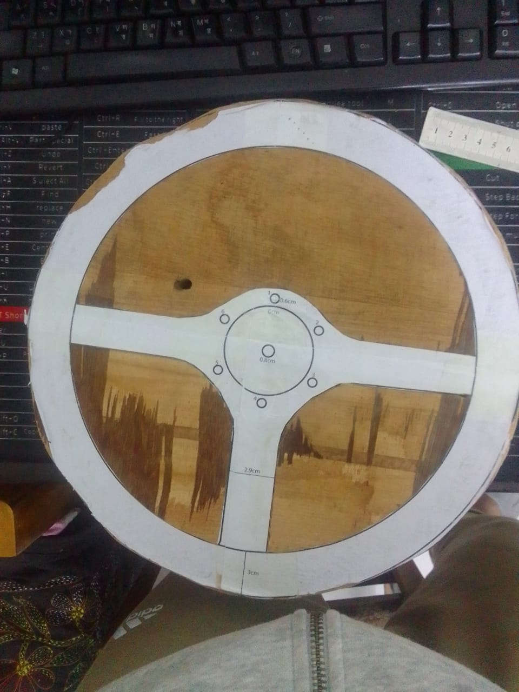
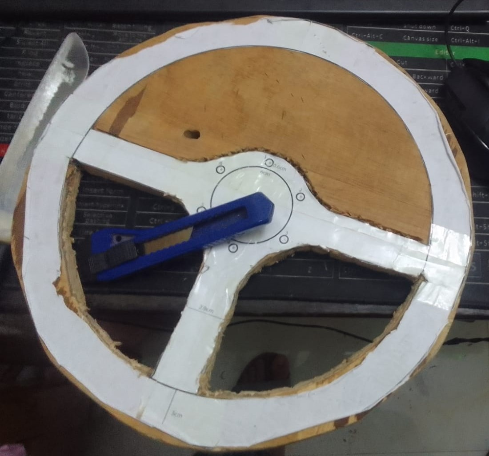
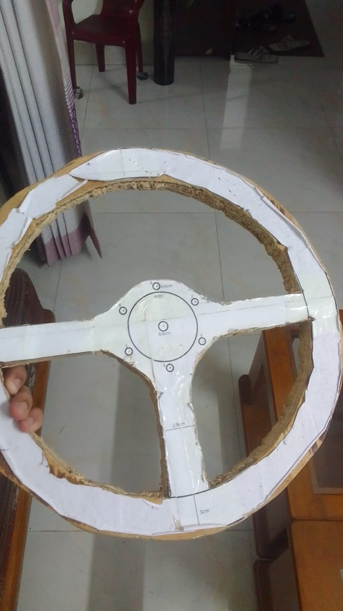

## DIY Sim Racing Setup
Official repository for all the codes, updates and design ideas of my Sim Racing Setup built from scratch. Note that most parts are built from 27mm of spare unused wood that I had lying around.

# Wheel
The Steering Wheel was a simple build. I just took a simple template from the internet, put it into Illustrator and drew it to size with proper dimensions and length markings. Then I printed the design and glued it to a block of wood. Since I didn't have access to any power tools, I used a handsaw to cut the outside part. I used a screwdriver and hammer to dig holes along the lines of the inner part until the pieces where loose enough to break off (I had to use my chair and bodyweight to get enough force to break them even after making the holes).

After doing all this, to strengthen the wood(according to Gemini so forgive me if it's wrong) I mixed water with fevicol glue and basically soaked the wheel with the mixture, letting it dry overnight. I then colored the wheel black and inserted M6 bolts around the center while covering the center hole with a bottle cap(that can be unscrewed if needed) which I glued a GT logo on to to make it look a little cool perhaps. I finished the wheel by wrapping it with black and red tape, purposefully keeping the design on the outer part.

## 📜 Licensing

This project uses a dual-licensing approach to cover both software and hardware/media assets:

* **Software & Code:** All code snippets, scripts, and firmware in this repository are licensed under the [MIT License](LICENSE).
* **Documentation, Images, & 3D Designs:** All photographs, build guides, and 3D printing files (STLs/STEP) are licensed under a [Creative Commons Attribution-NonCommercial-ShareAlike 4.0 International License](https://creativecommons.org).

### What this means for the DIY community:
* You are **free** to download, print, build, and modify this sim setup for your personal use.
* If you share your build online or remix my 3D designs, you **must give credit** back to this project.
* You **cannot sell** my 3D prints, build kits using my photos/guides, or commercialize this setup without my explicit permission.
