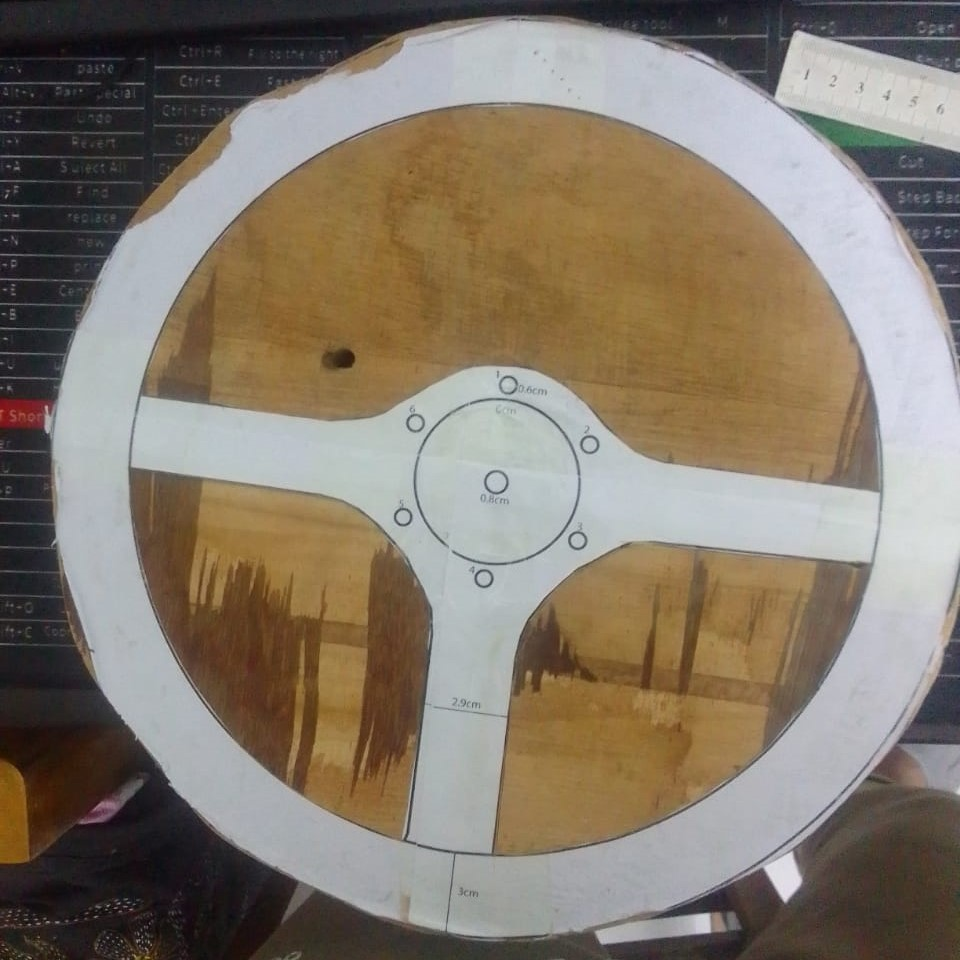
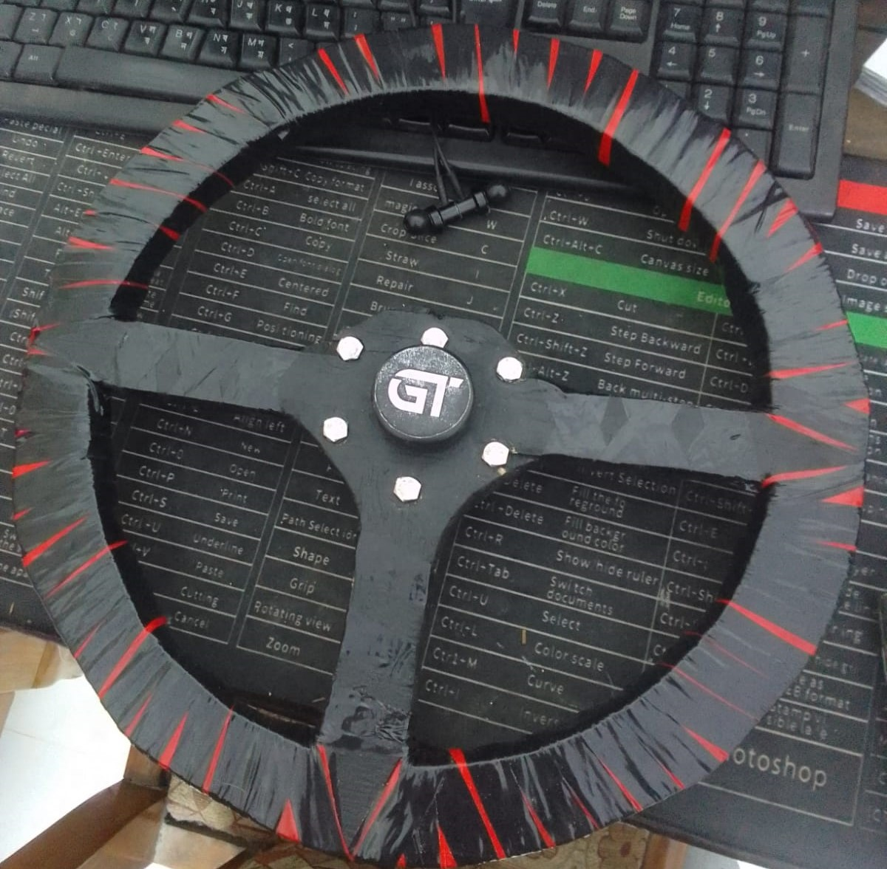
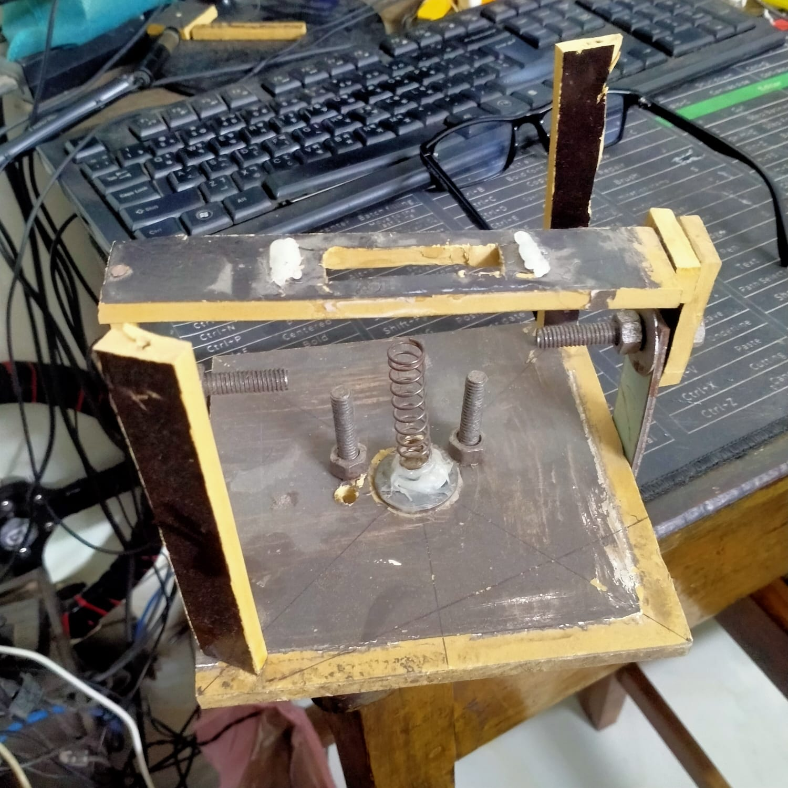
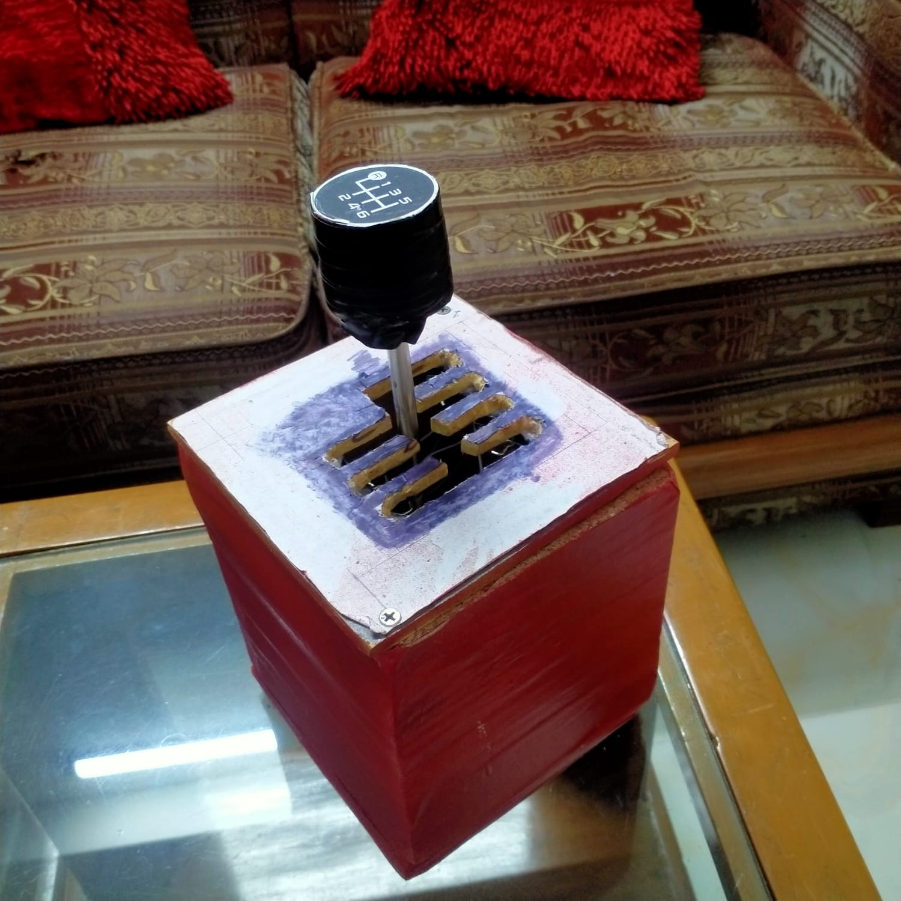
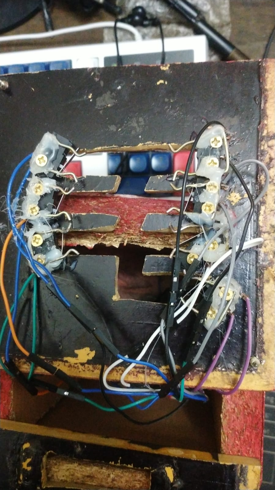
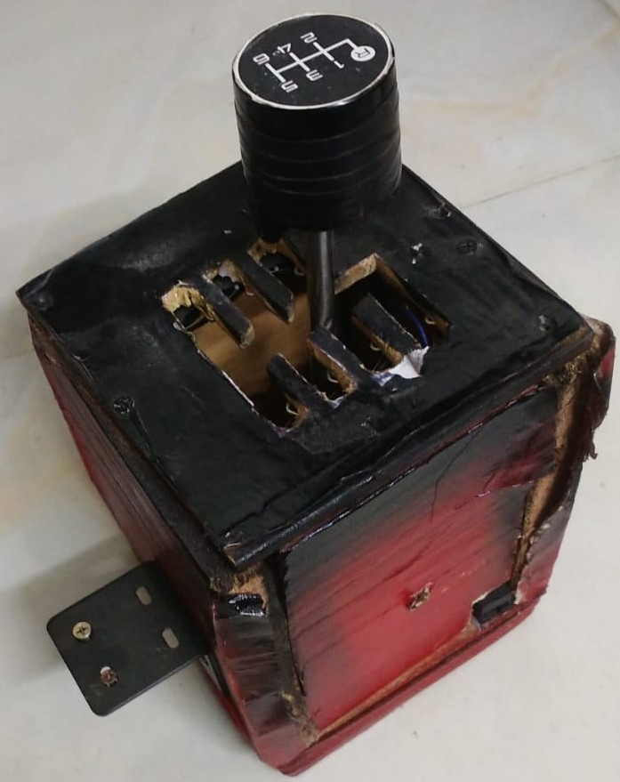

# DIY Sim Racing Setup
Official repository for all the codes, updates and design ideas of my Sim Racing Setup built from scratch. Note that most parts are built from 27mm of spare unused wood that I had lying around. All the images, codes, and designs are included in separate folders. If a video is mentioned, you can click the thumbnail image to go that video.

## Wheel
The Steering Wheel was a simple build, but rather taxing for since I lacked any power tools. I started with a random template from the internet and some guides about the dimensions. After that, I opened up illustrator and drew my own design. It took a few tries but I eventually came out with a simple and working design.

Cutting was the hard part. As I mentioned before, I had zero access to any kind of power tools. Although I did have access to woodwork shops near me, at the time I didn't think this project would become this big so I didn't really want to bother them with this little thing of mine. 

So, I brought two handsaws(small and large) and a hacksaw blade(just the blade as I short on money at the time) and got down to work. I started by cutting the wheel out of the board I had glued the paper design into, using the hacksaw blade to make cuts before using my handsaw to cut along that cut. The circular shape made it harder but I was able to manage. I sanded it down as best as I could before moving onto the inner ones. 

This part stumped me as for a good while I didn't know what to do. A handsaw wouldn't be of any use here unless I cut the outer rim, which risked the whole wheel breaking into two and I didn't want that after all the effort I had already put in. Desperate, I came up with a plan. A screwdriver and a hammer. First I made holes along the lines of the cutout, then I forced the part out with sheer force(my chair + bodyweight + A knife to sometimes deepening the cuts. This took way too much effort). Thankfully, at the end the wheel came out in one piece and I sanded the inner parts to smoothen it the best I could.

To strengthen the wood(according to Gemini so forgive me if it's wrong) I mixed water with fevicol glue and soaked the wheel with the mixture, letting it dry overnight. I then colored the wheel black and inserted M6 50mm bolts around the center while covering the center M8 hole with a bottle cap(that can be unscrewed if needed) which I glued a GT logo on for design sakes. I finished the wheel by wrapping it with black and red electrical tape, purposefully keeping the design on the outer part.

The bolts were installed to latched onto a custom made wooden hub.

## H-Shifter
This is actually what this whole project started with. Manual cars always fascinated me(Also I was watching Initial D at the time of building this). Since I didn't have access to one I thought of trying to craft one myself. So, I brought some limit switches, and Arduino Leonardo and got down to work with some leftover PVC Board I had.

This is where I have to give credits to a YouTuber called "Tech at Home". His tutorial is what I followed to build my first Prototype of the 6+1 H-Shifter.

My Prototype(Note, this picture was taken after I had already built my current version):

The idea was simple. A simple square structure with a custom U-clamp that followed the stick and helped it click into place via two metal clips. The top PVC board would have the H pattern with limit switches installed underneath in such a way that when the stick clicks into place, the switch at that gear position would be pressed. I connected the switches to an Arduino Leonardo(programmed with a simple code) and it was done!

However, this design came with quite a few issues:
<ol type="number">
<li>The structure was very loose and flimsy. Shifting each time caused it to bend slightly and be at risk of breaking(which it did a few times).</li>
<li>The clicks were inconsistent. At each gear, the stick clicked in somewhat different and sometimes didn't travel all the way. Though I did edit the prototype to make this better it still was a clear issue that drove out the immersion.</li>
<li>Hard to keep still. It didn't have any latch or clamps attached so I would just press the bottom board under the table to keep it still. This resulted in the shifter being in a very awkward position too.</li>
<li>The centering spring was too loose.</li>
<li>Plainly speaking, this looked bad aesthetically as well.</li>
</ol>

Funnily enough, I actually did not touch this H-Shifter until after I was done making my first pedals and Wheel base prototypes. But when I did, I developed it into a proper version 2:

This already fixed several of the issues. The box was made of solid wood so it was much more rigid. I replaced the center spring for a stronger one which made the feel better. Instead of running wires, I attached an RJ45 connector on the Arduino Leonardo and the shifter for better connection. Aesthetically, this version looked much more appealing. 

However, despite solving some, a lot of the issues still remained. I had changed the style of the clips, moving from two clips that changed positions to an individual clip for each gear slot. But the clip inconsistency was still there, and sometimes the clips snapped off due to it being held on only by glue underneath. The placement was still an issue. The wiring underneath was very messy and disorganized and often got twisted together when the stick moved around, causing some connections to sometimes open on their own.

This lead me to develop the third version:

Now, granted, this version looks a lot less appealing than the last, but actually is much more practical. This shifter clamped directed to my chair and was useable in proper position. For the clips issue, I at first thought to bring back the two-clip design from V1, but ended up not doing that(hence the hole in the wall). Instead, I changed their position. In V2, the clips were glued above the switches and resulted in them snapping off when I clicked the shift stick in fast. But now, I changed that to settle the clips under the switches. So, when the switches are screwed in, they automatically clamp the clips down hard. I also streamlined the wiring undearneath, making it much cleaner.

But, this version carries a few issues I would say:
1)Since it is screwed directly into my chair, it's inefficient and has become loose due to screwing it in and out a bunch of times already.
2)Aesthetically it looks bad.
3)The spring still feels a bit loose.

I plan on improving this in the near future, but for now this is what I'm working with.

## Pedals

# 📜 Licensing

This project uses a dual-licensing approach to cover both software and hardware/media assets:

* **Software & Code:** All code snippets, scripts, and firmware in this repository are licensed under the [MIT License](LICENSE).
* **Documentation, Images, & 3D Designs:** All photographs, build guides, and 3D printing files (STLs/STEP) are licensed under a [Creative Commons Attribution-NonCommercial-ShareAlike 4.0 International License](https://creativecommons.org).

### What this means for the DIY community:
* You are **free** to download, print, build, and modify this sim setup for your personal use.
* If you share your build online or remix my 3D designs, you **must give credit** back to this project.
* You **cannot sell** my 3D prints, build kits using my photos/guides, or commercialize this setup without my explicit permission.
